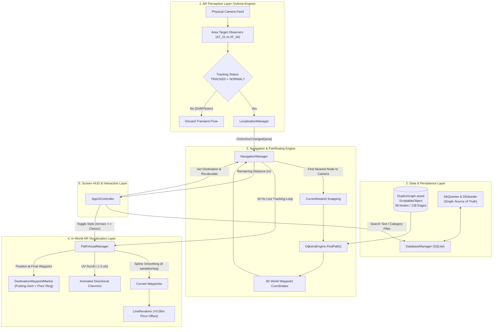

# Nexpath AR Navigation System — Comprehensive Architecture & Engineering Blueprint

This document provides a complete, end-to-end technical rundown of the **Nexpath AR Navigation** project. It is authored for software engineers, technical artists, AR developers, and stakeholders who were not part of the initial development cycle. It details not only **what** each component does, but **why** it was designed this way, **how** the subsystems interact under the hood, and how to maintain or extend the codebase.

---

## Table of Contents
1. [Executive Summary & Project Purpose](#1-executive-summary--project-purpose)
2. [Technical Stack & Technology Selection Rationale](#2-technical-stack--technology-selection-rationale)
3. [High-Level System Architecture & End-to-End Data Flow](#3-high-level-system-architecture--end-to-end-data-flow)
4. [Subsystem Deep Dives with Technical Explanations](#4-subsystem-deep-dives-with-technical-explanations)
   - [4.1 AR Localization & Multi-Area Management (`LocalizationManager.cs`)](#41-ar-localization--multi-area-management-localizationmanagercs)
   - [4.2 The Topological Graph Architecture (`Nodes.cs`, `Edges.cs`, `GraphDatabase.cs`)](#42-the-topological-graph-architecture-nodescs-edgescs-graphdatabasecs)
   - [4.3 Shortest-Path Computation Engine (`DijkstraEngine.cs`)](#43-shortest-path-computation-engine-dijkstraenginecs)
   - [4.4 Real-Time Live Navigation Execution (`NavigationManager.cs`)](#44-real-time-live-navigation-execution-navigationmanagercs)
   - [4.5 In-World AR Visual Guidance System (`PathVisualManager.cs` & `DestinationWaypointMarker.cs`)](#45-in-world-ar-visual-guidance-system-pathvisualmanagercs--destinationwaypointmarkercs)
   - [4.6 Offline Embedded Database & Native SQLite Layer (`DatabaseManager.cs`, `DbQueries.cs`, `DbSeeder.cs`, `SqliteNative.cs`)](#46-offline-embedded-database--native-sqlite-layer-databasemanagercs-dbqueriescs-dbseedercs-sqlitenativecs)
   - [4.7 User Interface & Mobile HUD Controller (`AppUIController.cs`)](#47-user-interface--mobile-hud-controller-appuicontrollercs)
   - [4.8 Custom Unity Editor Tooling & Automation (`NavGraphEditorWindow.cs`)](#48-custom-unity-editor-tooling--automation-navgrapheditorwindowcs)
5. [Directory Structure & Asset Inventory](#5-directory-structure--asset-inventory)
6. [Complete Runtime Execution Lifecycle Walkthrough](#6-complete-runtime-execution-lifecycle-walkthrough)
7. [Engineering Pitfalls, Root-Cause Post-Mortems & Solutions](#7-engineering-pitfalls-root-cause-post-mortems--solutions)
8. [Developer Maintenance Cheat Sheet](#8-developer-maintenance-cheat-sheet)

---

## 1. Executive Summary & Project Purpose

### 1.1 The Problem: Indoor Navigation & GPS Denial
Standard smartphone navigation systems rely almost exclusively on Global Navigation Satellite Systems (GNSS: GPS, GLONASS, Galileo, BeiDou). While exceptionally accurate in open outdoor environments, satellite radio signals cannot penetrate modern architectural reinforced concrete, steel girders, and tinted low-E glass. Inside multi-story buildings, hospitals, university campuses, and transportation terminals, GPS positioning degrades to dozens of meters of error or fails entirely. 

Furthermore, standard 2D mapping tools cannot address **vertical elevation changes** (staircases, elevators, floor transitions) or distinguish between overlapping floors. Visitors and students experience spatial disorientation when attempting to locate specific lecture halls, faculty offices, and specialized laboratories across complex, interconnected wings.

### 1.2 The Solution: Augmented Reality + Spatial Graph Topology
**Nexpath AR** solves this problem by combining two complementary paradigms:
1. **Photogrammetric Spatial Localization:** Utilizing high-precision 3D scans of the physical building via PTC Vuforia Engine Area Targets. The mobile device camera matches physical visual landmarks (walls, doors, signage, structural pillars) to register the user's millimeter-accurate 6-Degrees-of-Freedom (6-DoF) pose in the building without external hardware beacons or Wi-Fi fingerprinting.
2. **Topological Graph Pathfinding:** A pre-authored mathematical graph mapping corridors, doorways, and staircases. Dijkstra's shortest-path algorithm resolves the optimal path from the user's localized position to their chosen destination.
3. **In-World Augmented Reality Visuals:** Conformal AR guidance elements (animated directional chevron arrows, solid raycasted beams, floating 3D destination pins, and billboarded room text) render directly over the real world via the smartphone camera display, guiding the user turn-by-turn.
4. **Completely Offline Operation:** All databases, search algorithms, spatial meshes, and navigation graphs reside directly on the device. The app requires zero internet access to function.

---

## 2. Technical Stack & Technology Selection Rationale

| Component | Choice | Version / Architecture | Technical Explanation & Selection Rationale |
| :--- | :--- | :--- | :--- |
| **Game Engine** | Unity Editor | `6000.6.5f1` (Unity 6) | Chosen for its robust mobile rendering pipeline, mature Android build toolchain, rapid C# iteration, and deep integration with AR SDKs. |
| **AR Framework** | PTC Vuforia Engine | Area Targets Multi-Dataset | Selected over standard plane-detection ARCore/ARKit because Area Targets anchor to real-world 3D scanned point-cloud meshes of physical spaces, eliminating drift across hundreds of meters. |
| **Target OS** | Android | API 26+ (Android 8.0 Oreo to Android 14+) | Target platform for user deployment. Configured with portrait orientation for natural single-handed mobile navigation. |
| **Scripting Backend** | IL2CPP | ARM64 (`arm64-v8a`) | Compiles C# Intermediate Language (IL) into native C++ machine code before compiling Android binaries. Provides maximum computational speed for Dijkstra pathfinding and matrix transformations. |
| **Database Engine** | Embedded SQLite | Native C P/Invoke (`sqlite3`) | Provides high-speed relational SQL querying (instant `LIKE` text search, category filtering) without requiring an active network server or heavy third-party ORMs. |
| **UI System** | Unity uGUI + TextMeshPro | 1080x1920 Canvas Scaler | TextMeshPro provides crisp Signed Distance Field (SDF) font rendering in both 2D screen space and 3D world space billboards. |
| **Math & Curves** | Catmull-Rom Spline Interpolation | Custom C# math | Smooths raw, angular graph segments into curved, natural human walking paths. |

---

## 3. High-Level System Architecture & End-to-End Data Flow

The architecture is structured into decoupled, modular layers: Perception, Data, Core Logic, Visualization, and Interface.



### Explanation of Data Flow:
1. **Perception to Localization:** The camera captures video frames. Vuforia compares incoming feature descriptors against pre-scanned Area Target point clouds. When confident, it reports `TRACKED` with `NORMAL` status info to [`LocalizationManager.cs`](file:///C:/Users/achim/Documents/Unity%20Projects/NexpathARApp/Assets/ARNav_Phase1/Scripts/Localization/LocalizationManager.cs).
2. **Localization to Graph Snapping:** `LocalizationManager` fires `OnAnchorChanged`. [`NavigationManager.cs`](file:///C:/Users/achim/Documents/Unity%20Projects/NexpathARApp/Assets/ARNav_Phase1/Scripts/Navigation/NavigationManager.cs) finds the closest physical graph node to the camera's world position within that localized area.
3. **Graph to Pathfinding:** When the user selects a destination in the UI, `NavigationManager` queries [`DijkstraEngine.cs`](file:///C:/Users/achim/Documents/Unity%20Projects/NexpathARApp/Assets/ARNav_Phase1/Scripts/Navigation/DijkstraEngine.cs) with the start and destination node IDs. The engine traverses [`DuplexGraph.asset`](file:///C:/Users/achim/Documents/Unity%20Projects/NexpathARApp/Assets/ARNav_Phase1/Data/DuplexGraph.asset) and returns an ordered list of 3D Cartesian coordinates.
4. **Pathfinding to AR Rendering:** The raw node coordinates pass to [`PathVisualManager.cs`](file:///C:/Users/achim/Documents/Unity%20Projects/NexpathARApp/Assets/ARNav_Phase1/Scripts/Visual/PathVisualManager.cs), which elevates them $+8\,\text{cm}$ above the floor, applies Catmull-Rom spline curves, scrolls UV textures along the path, and spawns the 3D destination beacon.
5. **Continuous Tracking Loop:** Every 0.1 seconds ($10\,\text{Hz}$), `NavigationManager` checks the user's distance to the next waypoint, pops reached waypoints, anchors the leading vertex to the user's feet, and updates the distance banner on the HUD.

---

## 4. Subsystem Deep Dives with Technical Explanations

---

### 4.1 AR Localization & Multi-Area Management (`LocalizationManager.cs`)

#### Why is Multi-Area Management Needed?
A single, massive 3D scan of an entire multi-floor building creates files that exceed mobile memory limits and suffers from cumulative tracking drift across long corridors. Therefore, the building was scanned as **four distinct Area Targets**:
1. **`Nodes_AT_01` (Ground Floor Main Wing):** Entrance hall, main reception corridor, and Rooms 100 through 109.
2. **`Nodes_AT_02` (Central Staircase Core):** The vertical stair tower connecting the ground floor to the upper floor.
3. **`Nodes_AT_03` (Upper Floor North Wing):** Department laboratories (Rooms 206, 208), seminar room (Room 207), and exit doorways.
4. **`Nodes_AT_04` (Upper Floor South Wing):** Executive offices (HOD Room 200, Room 202, Room 205) and south corridor.

#### The Challenge of Overlapping Zones & Anchor Thrashing
When a user walks through a doorway connecting two scan zones (e.g. from `AT_01` into `AT_02`), Vuforia's camera may see feature points from both datasets simultaneously. Without hysteresis, the active anchor flips back and forth dozens of times per second, causing the in-game world origin to shake and path lines to jump erratically.

#### How `LocalizationManager.cs` Solves This:
```csharp
void HandleStatus(ObserverBehaviour behaviour, TargetStatus status)
{
    // 1. Strict Quality Filter: Only trust solid TRACKED + NORMAL
    if (status.Status == Status.TRACKED && status.StatusInfo == StatusInfo.NORMAL)
    {
        // 2. 1-Second Time Hysteresis: Prevent rapid switching in transition doorways
        if (behaviour.TargetName != ActiveAnchorName && Time.time - lastSwitchTime > 1.0f)
        {
            ActiveAnchorName = behaviour.TargetName;
            ActiveAnchor = behaviour;
            lastSwitchTime = Time.time;
            OnAnchorChanged?.Invoke(ActiveAnchorName);
        }
    }
}
```
- **Tracking Quality Filter:** Vuforia can report `Status.EXTENDED_TRACKED` (estimating pose based on device IMU when visual features are lost). Extended tracking is vulnerable to drift over time. `LocalizationManager` rejects everything except `Status.TRACKED` + `StatusInfo.NORMAL`, ensuring the system only localizes when seeing real visual landmarks.
- **1-Second Hysteresis Window:** When entering a doorway, once an anchor switch occurs, the manager locks switching for 1.0 full second. This eliminates high-frequency jitter and stabilizes path rendering.
- **Transition Node Architecture:** Specialized gateway nodes (`L1_AT01_EXIT <-> L1_AT02_ENTRY`, `L2_AT02_EXIT <-> L2_AT03_ENTRY`, etc.) connect the coordinate spaces. Even as the active anchor switches from one target to another, the navigation graph links them seamlessly.

---

### 4.2 The Topological Graph Architecture (`Nodes.cs`, `Edges.cs`, `GraphDatabase.cs`)

#### Why Use a Graph Instead of Unity NavMesh?
Standard Unity NavMesh is designed for autonomous AI agents walking on continuous 3D surfaces. In mobile AR indoor navigation, NavMesh presents major drawbacks:
1. NavMesh requires continuous geometric mesh colliders for the entire building, adding megabytes of polygon overhead to mobile RAM.
2. In multi-target AR, coordinate origins can shift slightly between tracking areas. NavMesh cannot easily stitch across shifting spatial reference frames.
3. Graph networks are mathematically deterministic, require almost zero memory, execute Dijkstra calculations in under 1 millisecond, and easily support discrete attributes (stair penalties, elevator tags, one-way corridors, and temporary closures).

#### Component Breakdown:

##### 1. Node Data Structure ([`Nodes.cs`](file:///C:/Users/achim/Documents/Unity%20Projects/NexpathARApp/Assets/ARNav_Phase1/Scripts/Navigation/Nodes.cs))
Represents a physical waypoint in the building:
- `Id` (string): Unique identifier following a systematic naming convention (`L1_R105` = Level 1 Room 105; `L1_CorA` = Level 1 Corridor A; `STAIR_L1_BOT` = Staircase Level 1 Bottom).
- `Position` (Vector3): Global Cartesian world coordinates $(X, Y, Z)$ in meters.
- `Floor` (int): Vertical floor index ($1$ or $2$).
- `AuthoritativeArea` (string): Identifies which Vuforia Area Target owns this node (`AT_01`, `AT_02`, `AT_03`, `AT_04`).
- `IsTransition` (bool): Flagged as `true` for doorway boundary points and stair landings.

##### 2. Edge Data Structure ([`Edges.cs`](file:///C:/Users/achim/Documents/Unity%20Projects/NexpathARApp/Assets/ARNav_Phase1/Scripts/Navigation/Edges.cs))
Represents a navigable walking corridor between two nodes:
- `From` & `To` (string): Directed pair connecting node A to node B.
- `Cost` (float): The physical Euclidean distance in meters ($\sqrt{\Delta x^2 + \Delta y^2 + \Delta z^2}$).
- `IsStairs` (bool): Identifies vertical steps, allowing Dijkstra to filter or penalize stairs for accessible routing.
- `IsElevator` (bool): Reserved for elevator transitions.
- `Enabled` (bool): Allows dynamic runtime obstruction (e.g., closing a corridor under maintenance without deleting the graph data).

##### 3. Graph Database Asset ([`GraphDatabase.cs`](file:///C:/Users/achim/Documents/Unity%20Projects/NexpathARApp/Assets/ARNav_Phase1/Scripts/Navigation/GraphDatabase.cs))
A Unity `ScriptableObject` serialized to disk at [`Assets/ARNav_Phase1/Data/DuplexGraph.asset`](file:///C:/Users/achim/Documents/Unity%20Projects/NexpathARApp/Assets/ARNav_Phase1/Data/DuplexGraph.asset):
- Contains **38 nodes** and **138 directed edges** (69 bidirectional pairs).
- Stored as a native project asset compiled directly into the application binary, ensuring immediate availability on cold start without waiting for external file loading.

---

### 4.3 Shortest-Path Computation Engine (`DijkstraEngine.cs`)

#### Algorithmic Explanation:
[`DijkstraEngine.cs`](file:///C:/Users/achim/Documents/Unity%20Projects/NexpathARApp/Assets/ARNav_Phase1/Scripts/Navigation/DijkstraEngine.cs) implements Dijkstra's algorithm to guarantee the mathematically shortest path between any start waypoint and destination.

```csharp
public static List<string> FindPath(GraphDatabase g, string start, string end,
    bool allowStairs = true, bool allowElevator = true)
{
    var dist = new Dictionary<string, float>();
    var prev = new Dictionary<string, string>();
    var unvisited = new HashSet<string>();

    foreach (var n in g.nodes) { dist[n.Id] = float.PositiveInfinity; unvisited.Add(n.Id); }
    dist[start] = 0;

    while (unvisited.Count > 0)
    {
        string u = null; float best = float.PositiveInfinity;
        foreach (var id in unvisited)
            if (dist[id] < best) { best = dist[id]; u = id; }
        
        if (u == null || float.IsPositiveInfinity(best)) break; // Disconnected island
        if (u == end) break; // Reached target
        unvisited.Remove(u);

        foreach (var e in g.edges)
        {
            if (!e.Enabled || e.From != u) continue;
            if (!unvisited.Contains(e.To)) continue;
            if (e.IsStairs && !allowStairs) continue; // Accessibility constraint
            
            float alt = dist[u] + e.Cost;
            if (alt < dist[e.To])
            {
                dist[e.To] = alt;
                prev[e.To] = u;
            }
        }
    }
    // Backtrack from end to start using predecessor dictionary
    ...
}
```

#### Step-by-Step Execution:
1. **Distance Initialization:** The engine initializes all node distances to $+\infty$ and sets the starting node distance to $0$.
2. **Greedy Minimum Node Selection:** In each iteration, it selects the unvisited node $u$ with the lowest accumulated cost $\text{dist}[u]$.
3. **Edge Relaxation with Constraints:** For every outgoing edge $(u \to v)$:
   - If `!e.Enabled`, the edge is bypassed.
   - If `e.IsStairs && !allowStairs`, the edge is skipped (supporting accessibility routing for wheelchairs).
   - If traversing through $u$ offers a shorter distance to $v$ than previously discovered ($\text{dist}[u] + e.\text{Cost} < \text{dist}[v]$), the engine updates $\text{dist}[v]$ and records $u$ as the predecessor: $\text{prev}[v] = u$.
4. **Predecessor Backtracking:** Once the destination node is reached, the engine follows the `prev` map backward from destination to start, reverses the list, and produces the optimal sequence of node IDs.
5. **Coordinate Translation (`ToWorldPath`):** The sequence of node IDs is translated into real-world 3D coordinates via `g.Get(id).Position`.

---

### 4.4 Real-Time Live Navigation Execution (`NavigationManager.cs`)

[`NavigationManager.cs`](file:///C:/Users/achim/Documents/Unity%20Projects/NexpathARApp/Assets/ARNav_Phase1/Scripts/Navigation/NavigationManager.cs) is the central heartbeat of active navigation. It runs at $10\,\text{Hz}$ (every $0.1\,\text{s}$) rather than every frame ($60\,\text{Hz}$) to save battery and eliminate micro-jitter.

#### 1. Real-Time Foot-Anchored Leading Vertex
In mobile AR, if a navigation line simply connects static graph nodes, the line starts behind or ahead of the user as they walk between nodes. To create an intuitive visual guide:
```csharp
float floorY = CurrentWorldPath.Count > 1 ? CurrentWorldPath[1].y : CurrentWorldPath[0].y;
CurrentWorldPath[0] = new Vector3(camPos.x, floorY, camPos.z);
```
The first vertex of the rendered path is dynamically replaced with the user's camera $(X, Z)$ coordinates projected down onto the corridor floor elevation. The path appears to stream continuously from directly beneath the user's feet.

#### 2. Waypoint Popping (1.2m Radius)
```csharp
float distToNext = Vector2.Distance(
    new Vector2(camPos.x, camPos.z),
    new Vector2(nextWaypoint.x, nextWaypoint.z)
);
if (distToNext < waypointThreshold) // 1.2 meters
{
    CurrentWorldPath.RemoveAt(1); // Advance route to next corner
}
```
When the user arrives within 1.2 meters of the next turning point or corner, that waypoint is consumed and removed from the active path. The navigation visual smoothly shortens, drawing the user forward to the next corner.

#### 3. Off-Track Corridor Recalculation (6.0m Threshold)
If a user ignores instructions and turns down the wrong hallway, their physical distance from the planned path segment will exceed $6.0\,\text{meters}$. When detected:
```csharp
if (distFromSegment > offTrackThreshold) // 6.0 meters
{
    Debug.Log("[Nav] Off-track detected. Recalculating from new position...");
    Recalculate();
}
```
The system identifies the nearest node in their new hallway and instantly recalculates a brand new route to the destination.

---

### 4.5 In-World AR Visual Guidance System (`PathVisualManager.cs` & `DestinationWaypointMarker.cs`)

#### 1. Dual-Style Path Rendering
Different lighting environments and user preferences require visual flexibility. [`PathVisualManager.cs`](file:///C:/Users/achim/Documents/Unity%20Projects/NexpathARApp/Assets/ARNav_Phase1/Scripts/Visual/PathVisualManager.cs) implements two distinct rendering modes:

1. **Animated Directional Arrows Mode:**
   - **Material:** `LineRenderMat_Arrows.mat` using texture `nav_arrow_strip.png`.
   - **Texture Mode:** `LineTextureMode.Tile` tiling high-contrast chevrons along the physical length.
   - **Width:** $0.40\,\text{m}$ (wide, legible ground strip).
   - **UV Scroll Animation:**
     ```csharp
     line.material.mainTextureOffset -= Vector2.right * scrollSpeed * Time.deltaTime;
     ```
     By subtracting the horizontal UV texture offset at $1.3\,\text{units/s}$ in `Update()`, the arrows continuously animate forward along the floor in the direction of travel.
2. **Classic Solid Raycast Line Mode:**
   - **Material:** `LineRenderMat_Classic.mat`.
   - **Texture Mode:** `LineTextureMode.Stretch`.
   - **Width:** $0.20\,\text{m}$ (minimalist solid cyan beam).
   - **Visual Profile:** A clean, glowing solid vector preferred by users in cluttered visual settings.

#### 2. Catmull-Rom Spline Curve Smoothing
Raw node-to-node line rendering creates harsh, angular 90-degree corners that look unnatural in AR. To solve this, `PathVisualManager` applies Catmull-Rom spline interpolation:
$$\mathbf{P}(t) = 0.5 \times \left( (2\mathbf{P}_1) + (-\mathbf{P}_0 + \mathbf{P}_2)t + (2\mathbf{P}_0 - 5\mathbf{P}_1 + 4\mathbf{P}_2 - \mathbf{P}_3)t^2 + (-\mathbf{P}_0 + 3\mathbf{P}_1 - 3\mathbf{P}_2 + \mathbf{P}_3)t^3 \right)$$
Each corridor segment is subdivided into 8 interpolated curve points. The resulting path naturally rounds corners, guiding users with smooth, sweeping curves.

#### 3. Z-Fighting Mitigation ($+0.08\,\text{m}$ Floor Offset)
When a 3D line renderer is drawn at the exact mathematical Y-coordinate of a physical floor ($Y = -1.50\,\text{m}$), mobile graphics hardware struggles with depth buffer precision, causing **Z-fighting** (rapid black flickering where the line intersects the floor). All path vertices are systematically elevated by $+0.08\,\text{m}$ ($8\,\text{cm}$) above the floor plane, guaranteeing clean visibility above real-world carpets and tiles.

#### 4. Procedural 3D Destination Waypoint Pin ([`DestinationWaypointMarker.cs`](file:///C:/Users/achim/Documents/Unity%20Projects/NexpathARApp/Assets/ARNav_Phase1/Scripts/Visual/DestinationWaypointMarker.cs))
At the end of the route, an animated 3D beacon marks the target doorway:
- **Procedural Diamond Mesh:** A 3D dual-pyramid diamond generated in code, hovering at $Y = +1.10\,\text{m}$ above the floor, rotating continuously at $60^\circ/\text{s}$, and bobbing vertically ($\pm 0.15\,\text{m}$) using a sine wave.
- **Concentric Floor Pulse Ring:** A 32-segment circular ring mesh expanding from $0.45\,\text{m}$ to $0.65\,\text{m}$ on the floor, indicating the exact entrance spot.
- **Camera-Facing Billboard Text ([`BillboardText.cs`](file:///C:/Users/achim/Documents/Unity%20Projects/NexpathARApp/Assets/ARNav_Phase1/Scripts/Core/BillboardText.cs)):** Uses `transform.LookAt` in `LateUpdate()` so the room name label rotates smoothly to always face the user's camera regardless of their walking angle.
- **Proximity Reveal:** Automatically activates when the user is within 15 meters of the destination.

---

### 4.6 Offline Embedded Database & Native SQLite Layer (`DatabaseManager.cs`, `DbQueries.cs`, `DbSeeder.cs`, `SqliteNative.cs`)

#### Why SQLite for Indoor Navigation?
While graph pathfinding operates in 3D vector space, **user interaction** requires structured relational queries:
- Full-text search with partial matching (`"Dr Ez"` matching `"Office Dr Ezema"`).
- Categorical filtering (`Office`, `Classroom`, `Laboratory`).
- Metadata management (descriptions, room titles, floor associations).
Using SQLite provides instant SQL indexing and offline persistence on mobile devices.

#### Component Architecture:

```
Assets/ARNav_Phase1/Scripts/Core/
├── SqliteNative.cs        (Direct P/Invoke bindings to native sqlite3 shared library)
├── DatabaseManager.cs     (Connection lifecycle, schema definitions, persistent storage)
├── DbQueries.cs          (Search queries, LocationRow data structure, StaticLocations single source)
├── DbSeedData.cs          (Hardcoded node arrays for offline bootstrapping)
└── DbSeeder.cs            (SQLite node/edge insertion, location table synchronizer)
```

1. **Native P/Invoke Interop ([`SqliteNative.cs`](file:///C:/Users/achim/Documents/Unity%20Projects/NexpathARApp/Assets/ARNav_Phase1/Scripts/Core/SqliteNative.cs)):**
   Bypasses heavy third-party .NET database libraries by calling directly into the native C SQLite shared library (`sqlite3.dll` on Windows Editor, `libsqlite3.so` on Android). It wraps native pointers: `sqlite3_open`, `sqlite3_prepare_v2`, `sqlite3_step`, `sqlite3_column_text`, and `sqlite3_close`.
2. **Database Lifecycle ([`DatabaseManager.cs`](file:///C:/Users/achim/Documents/Unity%20Projects/NexpathARApp/Assets/ARNav_Phase1/Scripts/Core/DatabaseManager.cs)):**
   Configured with `[DefaultExecutionOrder(-100)]` to ensure the database initializes before any other script wakes up. The database file is located at `Application.persistentDataPath/nexpath.db`.
3. **Automatic Boot Synchronization:**
   On mobile platforms, `Application.persistentDataPath` preserves files across application updates. If an app relied only on `if (!File.Exists(dbPath)) CreateAndSeed()`, any edits to room descriptions made by developers in newer APK builds would be ignored because the old database file already existed on the phone.
   `DatabaseManager` solves this via `SyncLocations()` on every boot:
   ```csharp
   void EnsureDatabase()
   {
       if (!File.Exists(DbPath)) CreateAndSeed();
       else if (reseedOnStart) { File.Delete(DbPath); CreateAndSeed(); }
       else 
       {
           Exec(SchemaSQL);
           using (var conn = OpenConn())
           {
               if (conn != null) DbSeeder.SeedLocations(conn); // Fast 2ms location refresh
           }
       }
   }
   ```
4. **Single Source of Truth ([`DbQueries.cs`](file:///C:/Users/achim/Documents/Unity%20Projects/NexpathARApp/Assets/ARNav_Phase1/Scripts/Core/DbQueries.cs)):**
   `StaticLocations` in `DbQueries.cs` is the single authoritative array in C#. Both the SQLite database and the offline fallback read directly from this array, preventing duplicate data fragmentation.

---

### 4.7 User Interface & Mobile HUD Controller (`AppUIController.cs`)

[`AppUIController.cs`](file:///C:/Users/achim/Documents/Unity%20Projects/NexpathARApp/Assets/ARNav_Phase1/Scripts/UI/AppUIController.cs) manages all screen-space interactions on an adaptive 1080x1920 portrait canvas.

```
Screen Overlay (1080x1920 Portrait)
├── Top Header
│   ├── Nexpath AR Branding & Status Indicator
│   └── Top Info Banner: "Navigating to Room 105 (24.2 m)"
├── Middle AR Viewport (Unobstructed camera feed)
│   ├── Floating 3D Room Labels (World Space TextMeshPro)
│   ├── Ground Conforming AR Path (Arrows / Classic Line)
│   └── Destination Waypoint Marker (Rotating Diamond + Floor Pulse)
├── Quick Action Floating Buttons
│   ├── Left (Y = -300): Tips Toggle Button (Purple Icon)
│   ├── Right (Y = -300): Search Toggle Button (Cyan Icon)
│   └── Bottom Right: Path Style Switcher (Arrows <-> Solid Line)
└── Modal Overlays (Opened On Demand)
    ├── Search & Filter Drawer (Search Bar + Office/Classroom/Lab Pills + Results ScrollView)
    ├── Interactive Tips Modal (Lighting, scanning, stair guidance)
    └── Destination Arrived Celebration Banner (Dismissable popup within 1.8m)
```

#### Detailed Feature Explanations:
1. **Debounced Search Input:**
   Typing in the search input field triggers `searchBar.onValueChanged`, executing a dynamic SQL query (`SELECT ... WHERE name LIKE '%query%'`). Results instantiate dynamically inside the scrollable content view using `SearchResultItem.prefab`.
2. **Category Filter Pills:**
   Clicking `Office`, `Classroom`, or `Laboratory` toggles category filtering. Clicking an active filter resets it to display all locations.
3. **Tips Modal:**
   A dedicated purple floating action button on the left edge opens an interactive guide explaining:
   - Ensuring proper corridor lighting for Vuforia visual feature tracking.
   - Panning the camera across door frames to localize initially.
   - Toggling path styles for optimal contrast.
   - Exercising caution while walking near stairs.
4. **Live Distance Display:**
   During navigation, the top banner updates every 0.4 seconds, summing the Euclidean distances across all remaining path segments:
   `"Navigating to Room 200 (28.4 m)"`.
5. **Destination Arrival Popup:**
   When remaining distance drops below $1.8\,\text{meters}$, the HUD triggers `TriggerDestinationArrived()`, presenting a celebratory modal:
   `🎯 Room 200 — Office of the HOD`
   Clicking "Finish Navigation" stops active routing, clears path lines, hides markers, and returns the HUD to standby.

---

### 4.8 Custom Unity Editor Tooling & Automation (`NavGraphEditorWindow.cs`)

Managing 38 spatial nodes and 138 directed edges by hand in the Unity Inspector is error-prone and tedious. To streamline development, the project includes custom editor tooling accessible under `ARNav > Navigation Graph Editor`.

```
┌────────────────────────────────────────────────────────┐
│               AR Navigation Graph Editor               │
├────────────────────────────────────────────────────────┤
│ Scene Visualization:                                   │
│   [x] Show Visuals in Scene    Node Size: [===|===]    │
│   [x] Show Node Labels         [x] Show Edge Lines     │
├────────────────────────────────────────────────────────┤
│ Connect Selected Scene Nodes:                          │
│   Selected: L1_R106  <--->  L1_CorD                    │
│   Calculated Physical 3D Distance: 7.93 meters         │
│   Status: CONNECTED                                    │
│   [ Update Connection ]         [ Disconnect ]         │
├────────────────────────────────────────────────────────┤
│ Interactive Route Preview:                             │
│   Start: [ L1_R105 ▼ ]   End: [ L2_R200 ▼ ]            │
│   [ Find & Highlight Route in Scene ]                  │
│   Path Found: 10 waypoints | Distance: 34.2 m          │
├────────────────────────────────────────────────────────┤
│ Automations & Syncing:                                 │
│   [ Sync Node Coordinates from Scene Hierarchy ]       │
│   [ Auto-Connect Upper Floor (AT_02, AT_03, AT_04) ]   │
│   [ Export DuplexGraph Directly to SQLite Database ]   │
│   [ Re-seed SQLite Database from Scratch ]             │
└────────────────────────────────────────────────────────┘
```

#### Key Capabilities & Explanations:
- **Interactive SceneView Gizmos (`OnSceneGUI`):** Renders the graph visually inside the Unity Editor Scene view. Nodes are color-coded (Green for Level 1, Blue for Level 2, Yellow for Transition/Stairs, Red for Disconnected Islands). Edges render as solid lines or dotted lines for stairs.
- **Automatic Node Registration (`EnsureNodeInGraph`):** When a developer creates a new empty GameObject in the scene (e.g. `Node_L2_AT03_EXIT`) and selects it, the editor detects its position, infers floor level and authoritative area from its parent hierarchy, automatically creates the `Node` struct, registers it into `DuplexGraph.asset`, and saves the asset.
- **Two-Node Selection Connector:** Selecting two nodes in the Hierarchy instantly calculates their physical 3D distance and lets the developer click `[ Connect (Bidirectional) ]` or `[ Disconnect ]` with a single click.
- **In-Editor Route Simulator:** Engineers can select any Start node and Destination node from dropdowns and click `[ Find & Highlight Route in Scene ]`. Dijkstra runs instantly inside the Editor, rendering a bright gold trajectory through the building to verify connections before building APKs.
- **Direct SQLite Database Export:** A single button click exports the active visual graph from `DuplexGraph.asset` directly into SQLite tables (`Navigation_Nodes` and `Navigation_Edges`).

---

## 5. Directory Structure & Asset Inventory

```
Assets/
├── ARNav_Phase1/
│   ├── Data/
│   │   └── DuplexGraph.asset                 # Serialized ScriptableObject containing all 38 nodes & 138 edges
│   ├── Editor/
│   │   ├── CreateEditorBuildingMeshes.cs     # Editor reference geometry generator
│   │   ├── CreateRoomLabels.cs               # Procedural 3D World space room label generator
│   │   ├── NavGraphEditorWindow.cs           # Custom Unity Editor Window for visual graph authoring
│   │   ├── SetupSearchDropdownAndLabels.cs   # UI search dropdown builder utility
│   │   └── SetupTipsAndArrivalUI.cs          # UI tips popup & arrival banner builder utility
│   ├── Materials/
│   │   ├── LineRenderMat_Arrows.mat          # Material with scrolling UV chevron texture
│   │   └── LineRenderMat_Classic.mat         # Solid emissive cyan line material
│   ├── Prefabs/
│   │   └── SearchResultItem.prefab           # Instantiated template for search dropdown rows
│   ├── Scripts/
│   │   ├── Core/
│   │   │   ├── AppManager.cs                 # Root application coordinator
│   │   │   ├── BillboardText.cs              # TextMeshPro camera-facing rotation logic
│   │   │   ├── DatabaseManager.cs            # Native SQLite lifecycle and connection pool
│   │   │   ├── DbQueries.cs                  # Location search, node/edge queries & fallback data
│   │   │   ├── DbSeedData.cs                 # Offline node coordinates fallback array
│   │   │   ├── DbSeeder.cs                   # Database tables seeder & synchronization
│   │   │   └── SqliteNative.cs               # P/Invoke C interop bindings to libsqlite3
│   │   ├── Localization/
│   │   │   └── LocalizationManager.cs        # Vuforia Area Target observer & hysteresis filter
│   │   ├── Navigation/
│   │   │   ├── DijkstraEngine.cs             # Shortest-path routing engine
│   │   │   ├── Edges.cs                      # Edge data model & flags
│   │   │   ├── GraphDatabase.cs              # ScriptableObject definition & DB merge routines
│   │   │   ├── NavigationManager.cs          # Live tracking, waypoint popping & camera snapping
│   │   │   └── Nodes.cs                      # Node data model & coordinates
│   │   ├── UI/
│   │   │   └── AppUIController.cs            # HUD manager, search controller & modal controller
│   │   └── Visual/
│   │       ├── DestinationWaypointMarker.cs  # Procedural 3D glowing destination pin
│   │       └── PathVisualManager.cs          # Dual-mode path visualizer & Catmull-Rom smoother
│   └── Textures/
│       ├── nav_arrow_strip.png               # High-contrast directional chevron strip texture
│       ├── path_toggle_icon.png              # UI icon for path style switcher
│       ├── tips_icon.png                     # UI icon for tips button
│       ├── button1.png / button2.png         # UI button background sprites
│       └── CloseIcon.png / SearchIcon.png    # HUD vector sprites
└── Scenes/
    └── AR_Navigation.unity                   # Primary production scene
```

---

## 6. Complete Runtime Execution Lifecycle Walkthrough

Here is the step-by-step lifecycle of the application during a user journey:

```
[ App Cold Boot ]
      │
      ▼
1. DatabaseManager (Order -100) initializes native SQLite P/Invoke.
   Verifies "nexpath.db". Runs SyncLocations() to update room metadata.
      │
      ▼
2. NavigationManager (Order 10) loads DuplexGraph.asset (38 nodes, 138 edges).
   Subscribes to LocalizationManager.OnAnchorChanged.
      │
      ▼
3. Vuforia Engine activates mobile camera. User scans corridor.
   Vuforia matches physical visual features to "Nodes_AT_01".
      │
      ▼
4. LocalizationManager verifies Status.TRACKED + StatusInfo.NORMAL.
   OnAnchorChanged fires. NavigationManager snaps user position to nearest node ("L1_T1").
      │
      ▼
5. User taps Search Icon. Types "200" in search drawer.
   DbQueries.Search() queries SQLite. Displays "Room 200 (Office)".
      │
      ▼
6. User taps "Start Navigation".
   DijkstraEngine resolves optimal route:
   L1_T1 -> L1_AT01_EXIT -> L1_AT02_ENTRY -> STAIR_L1_BOT -> STAIR_L2_MID ->
   STAIR_L2_TOP -> L2_AT02_EXIT -> L2_AT04_ENTRY -> L2_CorC -> L2_CorD -> L2_R200.
      │
      ▼
7. PathVisualManager elevates vertices +8cm, applies Catmull-Rom spline curves,
   and streams scrolling chevron arrows forward along the floor.
   DestinationWaypointMarker spawns glowing diamond at Room 200.
      │
      ▼
8. User walks toward Room 200.
   - NavigationManager anchors path start directly to camera's floor projection.
   - Pops waypoints as user comes within 1.2 meters.
   - HUD updates distance banner: "Navigating to Room 200 (18.2 m)".
      │
      ▼
9. User reaches Room 200 (Remaining distance <= 1.8m).
   AppUIController triggers Arrival Celebration Banner:
   "🎯 Room 200 — Office of the HOD".
      │
      ▼
10. User taps "Finish Navigation".
    LineRenderer clears, destination beacon hides, HUD returns to standby.
```

---

## 7. Engineering Pitfalls, Root-Cause Post-Mortems & Solutions

During the engineering lifecycle of this project, several non-trivial bugs were encountered. The following post-mortems document their root causes and resolutions:

### 1. The Dual Source-of-Truth Problem (Runtime Graph Overwrite)
- **Symptom:** Developers added nodes and connected edges in the Navigation Graph Editor, but when building the APK, the new connections vanished at runtime.
- **Root Cause:** `NavigationManager.Start()` unconditionally called `graph.LoadFromDatabase()`, which queried SQLite. Because SQLite was populated by hardcoded fallback arrays in `DbSeedData.cs` (which only contained 36 original nodes), it overwrote `graph.nodes` in memory on launch, discarding newly authored nodes.
- **Permanent Solution:**
  1. Updated `NavigationManager.Start()` to check `if (graph.nodes.Count == 0 || graph.edges.Count == 0) graph.LoadFromDatabase();`. The compiled asset is treated as authoritative and is never overwritten.
  2. Implemented non-destructive merging in `GraphDatabase.cs` so any database queries merge rather than wipe asset data.

### 2. Missing Node Registration in Custom Editor Tooling
- **Symptom:** Developers created new scene GameObjects (`Node_L2_AT03_EXIT`) and connected them, but Dijkstra pathfinding could not find paths through them.
- **Root Cause:** The editor's `ConnectNodes()` function added edges to `graph.edges`, but never added the node definition to `graph.nodes`. Because Dijkstra iterates over `graph.nodes`, unlisted nodes were invisible to the algorithm.
- **Permanent Solution:** Implemented `EnsureNodeInGraph()` in [`NavGraphEditorWindow.cs`](file:///C:/Users/achim/Documents/Unity%20Projects/NexpathARApp/Assets/ARNav_Phase1/Editor/NavGraphEditorWindow.cs). Whenever any GameObject is selected or connected, the editor automatically inspects its transform, infers floor and area, adds it to `graph.nodes`, marks the asset dirty, and saves to disk.

### 3. Android `persistentDataPath` Stale Room Descriptions
- **Symptom:** Developers edited room descriptions in C#, but Android devices continued showing old descriptions even after installing an updated APK.
- **Root Cause:** Android preserves files in `Application.persistentDataPath` across APK updates. `DatabaseManager` checked `if (!File.Exists(DbPath)) CreateAndSeed();`. Because `nexpath.db` already existed from the previous build, it never re-seeded.
- **Permanent Solution:** Established `DbQueries.StaticLocations` as the single source of truth in C#. Added `DbSeeder.SeedLocations(conn)` into `DatabaseManager.EnsureDatabase()`, executing on every app boot to refresh the `Location` table in SQLite within 2 milliseconds without requiring app data wipes.

### 4. Overlapping Vuforia Scan Thrashing
- **Symptom:** Standing in transition doorways caused the screen to flicker violently between two different floor areas.
- **Root Cause:** When the camera saw feature points from two Area Targets simultaneously, Vuforia switched active targets back and forth at 60 Hz.
- **Permanent Solution:** Added tracking quality filtering (`Status.TRACKED` + `StatusInfo.NORMAL`) combined with a 1.0-second time hysteresis window in [`LocalizationManager.cs`](file:///C:/Users/achim/Documents/Unity%20Projects/NexpathARApp/Assets/ARNav_Phase1/Scripts/Localization/LocalizationManager.cs).

### 5. Line Renderer Z-Fighting
- **Symptom:** Navigation lines on the floor flickered with black horizontal visual artifacts.
- **Root Cause:** Coplanar rendering between the Unity LineRenderer mesh and the physical floor surface mesh.
- **Permanent Solution:** Applied a programmatic $+0.08\,\text{m}$ ($8\,\text{cm}$) vertical offset to all path vertices in [`PathVisualManager.cs`](file:///C:/Users/achim/Documents/Unity%20Projects/NexpathARApp/Assets/ARNav_Phase1/Scripts/Visual/PathVisualManager.cs).

---

## 8. Developer Maintenance Cheat Sheet

### How to Add a New Room to the System:
1. **Scene Placement:**
   - In the Unity Hierarchy, navigate to `NodesRoot` and select the appropriate area (e.g. `Nodes_AT_03`).
   - Create an empty GameObject named `Node_L2_R210` and place it physically in front of the room door.
2. **Graph Connection:**
   - Open `ARNav > Navigation Graph Editor`.
   - In the Scene view, select `Node_L2_R210` and the nearest corridor junction node.
   - Click **`Connect (Bidirectional)`**. The editor will automatically calculate physical distance, register the node into `DuplexGraph.asset`, and save.
3. **Location Metadata:**
   - Open [`DbQueries.cs`](file:///C:/Users/achim/Documents/Unity%20Projects/NexpathARApp/Assets/ARNav_Phase1/Scripts/Core/DbQueries.cs).
   - Add a new record to `StaticLocations`:
     ```csharp
     new LocationRow { id = 16, name = "Room 210", category = "Laboratory", description = "Robotics and Embedded Systems Lab", nodeName = "L2_R210" },
     ```
4. **Database Sync:**
   - In the Navigation Graph Editor, click **`[ Export DuplexGraph Directly to SQLite Database ]`**.
   - Build and run. The room is now fully searchable and navigable.

### How to Modify Room Names, Categories, or Descriptions:
1. Open [`DbQueries.cs`](file:///C:/Users/achim/Documents/Unity%20Projects/NexpathARApp/Assets/ARNav_Phase1/Scripts/Core/DbQueries.cs).
2. Locate the room entry inside `StaticLocations`.
3. Update the `name`, `category`, or `description` string.
4. Build the project. The app will automatically synchronize the database table on startup.

---
*Document generated for NexpathARApp — Repository Technical Documentation.*
